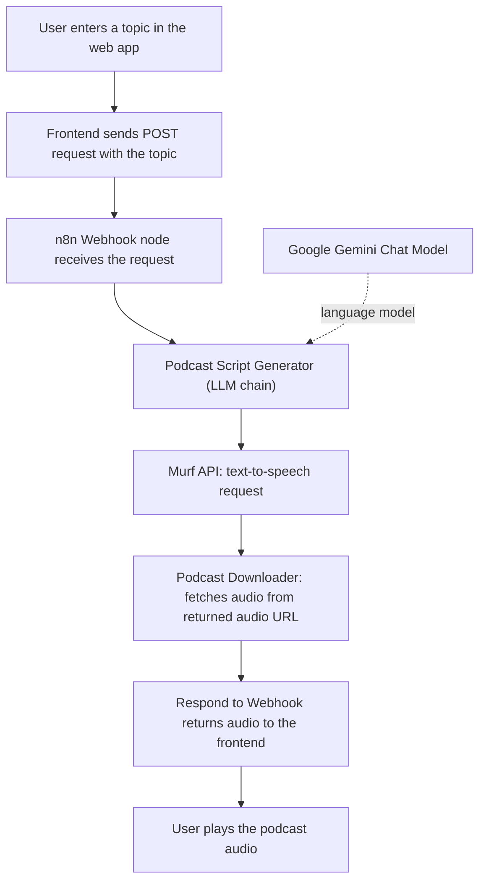
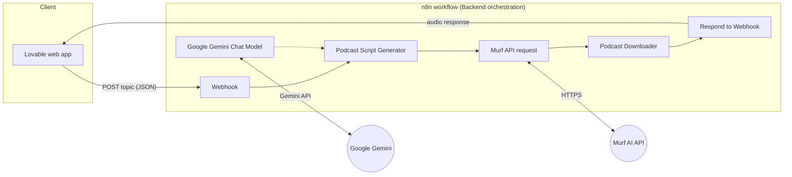

# Topic To Tune Creator | AI Podcast Generator

Turn any topic into a short, listenable podcast episode. Type a topic into the web app, and an automated n8n workflow writes a script with Google Gemini, converts it to speech with Murf AI, and sends the audio back for playback in the browser.

> **Status:** Portfolio / student project. Items marked `[PLACEHOLDER]` must be filled in with your own details. Nothing in this README contains real credentials or private URLs.

---

## Table of Contents

1. [Project Overview](#project-overview)
2. [Features](#features)
3. [How It Works](#how-it-works)
4. [Technology Stack](#technology-stack)
5. [Project Architecture](#project-architecture)
6. [Repository Structure](#repository-structure)
7. [Prerequisites](#prerequisites)
8. [Setup and Configuration](#setup-and-configuration)
9. [Environment Variables and API Credentials](#environment-variables-and-api-credentials)
10. [Running the Project](#running-the-project)
11. [Example Usage](#example-usage)
12. [Security Notes](#security-notes)
13. [Limitations and Future Improvements](#limitations-and-future-improvements)
14. [Author and License](#author-and-license)

---

## Project Overview

Creating a podcast normally means researching a topic, writing a script, and recording or synthesizing the voice. **Topic To Tune Creator** automates that pipeline for short episodes:

1. The user enters a topic on the website.
2. The frontend sends the topic to an **n8n webhook**.
3. n8n asks **Google Gemini** to write a podcast script of roughly two minutes when spoken.
4. n8n sends the script to the **Murf AI** text-to-speech API.
5. n8n downloads the generated audio and returns it to the frontend, which plays it.

The result is a simple, interactive way to go from an idea to a spoken, AI-generated mini-podcast without manual scripting or recording.

---

## Features

Only functionality present in the workflow and project description is listed here.

- **Topic input:** the user submits a podcast topic from the web interface.
- **AI-generated scripts:** Google Gemini writes an informative podcast script, prompted to be about two minutes long when spoken, returned as plain content without labels.
- **Text-to-speech conversion:** the script is converted to spoken audio through the Murf AI API (configured voice: `Natalie`, locale `en-US`).
- **Automated workflow orchestration:** a single n8n workflow chains the webhook, LLM, TTS, audio download, and response steps.
- **Audio playback:** the generated audio is returned to the frontend for playback.

---

## How It Works

### Request and response flow



### Step by step

1. **Webhook** receives a `POST` request. The workflow reads the topic from the request body field `text` (`body.text`).
2. **Podcast Script Generator** (an n8n LLM chain node) prompts the model to act as a professional podcast script writer and produce content for the topic, about two minutes when spoken, with no labels.
3. **Google Gemini Chat Model** is the language model attached to the script generator.
4. **Murf API** (HTTP Request node) sends the generated script to `https://api.murf.ai/v1/speech/generate` as the `text` field, along with `voiceId` and `locale`. The API key is sent in an `api-key` header.
5. **The Podcast Downloader** (HTTP Request node) fetches the audio file from the `audioFile` URL returned by Murf.
6. **Respond to Webhook** returns the result to the frontend. The webhook is configured to respond via this node (`responseMode: responseNode`), so the caller waits until the audio is ready.

---

## Technology Stack

| Technology | Purpose in this project |
|---|---|
| **Lovable** | Generates the web frontend where users enter a topic and play the audio. |
| **n8n** | Workflow automation and backend orchestration: exposes the webhook and chains all processing steps. |
| **Google Gemini** | Large language model that writes the podcast script. |
| **Murf AI API** | Text-to-speech service that converts the script into spoken audio. |
| **HTTP requests / n8n webhook** | Integration layer between the frontend, n8n, and Murf. |

> Frontend framework details depend on what Lovable generated for your project. `[PLACEHOLDER: confirm framework and build tooling from your Lovable project's source code]`

---

## Project Architecture



**Frontend to n8n communication:** the frontend makes an HTTP `POST` request to the n8n webhook URL, with the topic in a JSON body, for example:

```json
{ "text": "The history of the bicycle" }
```

n8n processes the request through the workflow and returns the generated audio in the webhook response. The frontend then plays it. Because the browser calls n8n directly, the webhook must allow requests from your frontend's origin (see [Security Notes](#security-notes)).

---

## Repository Structure

This is a **suggested** layout. These paths do not exist until you create them.

```text
topic-to-tune-creator/                  # suggested root folder
├── README.md                           # this file
├── frontend/                           # suggested: Lovable source code exported/synced from GitHub
│   └── ...                             # [PLACEHOLDER: contents depend on your Lovable project]
├── n8n/                                # suggested: workflow export
│   └── AI_Podcast_workflow_SAFE.json   # sanitized workflow (placeholder API key, no credentials)
├── docs/                               # suggested: optional documentation
│   └── screenshots/                    # suggested: add your own screenshots here
├── .gitignore                          # suggested: ignore .env files and local secrets
└── LICENSE                             # suggested: add your chosen license
```

---

## Prerequisites

- **Lovable account** with access to the Topic To Tune Creator project (to view, publish, or export the frontend).
- **n8n instance:** n8n Cloud or self-hosted, with a version that supports the LangChain nodes and Google Gemini chat model node used by the workflow.
- **Google Gemini API access:** an API key from Google AI Studio (or an equivalent supported Google credential).
- **Murf AI account** with API access and an API key.
- **A GitHub account** if you want to sync the frontend and publish this repository.
- **A modern web browser** for testing the published site.

---

## Setup and Configuration

### 1. Get the frontend source code from Lovable

1. Open your project in Lovable: `[PLACEHOLDER: your Lovable project URL]`
2. Connect the project to GitHub using Lovable's GitHub integration, which syncs the project code to a repository you own.
3. Clone that repository, or copy its contents into the `frontend/` folder of this repository.
4. Install and run the frontend following the instructions that apply to the generated project. `[PLACEHOLDER: confirm install and run commands from the generated project's package files]`

### 2. Import the n8n workflow

1. In n8n, create a new workflow, open the **⋯** menu, and choose **Import from File**.
2. Select `n8n/AI_Podcast_workflow_SAFE.json`.
3. The imported workflow contains six nodes: **Webhook**, **Podcast Script Generator**, **Google Gemini Chat Model**, **Murf API**, **The Podcast Downloader**, and **Respond to Webhook**.

> **Important:** the shared JSON is sanitized. Credentials and the Murf API key are **not** included, so they must be reconfigured after import. The workflow will not run until you do.

### 3. Configure Google Gemini credentials

1. Open the **Google Gemini Chat Model** node.
2. Create or select a Google Gemini credential in n8n and paste your own API key into the credential form (never into the workflow JSON).
3. Save the credential and confirm it is attached to the node.

### 4. Configure the Murf API key securely

The sanitized workflow sets the Murf key in the **Murf API** node's `api-key` header as the placeholder `YOUR_MURF_API_KEY_HERE`. Do not leave a real key typed directly into the node if you will export or share the workflow.

Recommended approach:

1. In n8n, create a **Header Auth** credential with:
   - **Name:** `api-key`
   - **Value:** your Murf API key
2. In the **Murf API** node, switch authentication to use that credential and remove the hard-coded header value.

If you keep the manual header for local testing, replace `YOUR_MURF_API_KEY_HERE` with your key only in your own n8n instance, and always re-sanitize before exporting.

Also confirm the `voiceId` (`Natalie`) and `locale` (`en-US`) values against Murf's current voice documentation and your account's available voices.

### 5. Connect the frontend to the n8n webhook

1. Open the **Webhook** node. It is configured for the `POST` method.
2. Copy the webhook URL. n8n shows two variants:
   - **Test URL:** used while the workflow is open in the editor and listening for a test event.
   - **Production URL:** used when the workflow is **active**.
3. Set the webhook URL in your frontend configuration. `[PLACEHOLDER: the file or setting in your Lovable project where the webhook URL is configured]`
4. Make sure the frontend sends `POST` requests with `Content-Type: application/json` and a body of `{ "text": "<topic>" }`.

---

## Environment Variables and API Credentials

The workflow itself does not read environment variables. Credentials live in n8n. The frontend needs one value: the webhook URL. All values below are placeholders.

| Item | Where it is configured | Placeholder |
|---|---|---|
| Google Gemini API key | n8n credential attached to the **Google Gemini Chat Model** node | `YOUR_GEMINI_API_KEY` |
| Murf API key | n8n **Header Auth** credential (header name `api-key`) used by the **Murf API** node | `YOUR_MURF_API_KEY_HERE` |
| n8n webhook URL | Frontend configuration | `https://<YOUR_N8N_HOST>/webhook/<YOUR_WEBHOOK_PATH>` |
| n8n test webhook URL | Frontend configuration, for testing only | `https://<YOUR_N8N_HOST>/webhook-test/<YOUR_WEBHOOK_PATH>` |

If your frontend reads the webhook URL from an environment variable, use a local, git-ignored file. The variable name is defined by your project:

```bash
# .env  (do NOT commit this file)
# [PLACEHOLDER: replace VARIABLE_NAME with the name your frontend actually uses]
VARIABLE_NAME=https://<YOUR_N8N_HOST>/webhook/<YOUR_WEBHOOK_PATH>
```

Never commit real API keys, tokens, passwords, personal identifiers, or private webhook URLs.

---

## Running the Project

### Option A: Test the workflow in n8n

1. Open the workflow in n8n and click **Execute workflow** (or **Listen for test event** on the Webhook node).
2. Send a request to the **test** webhook URL:

```bash
curl -X POST "https://<YOUR_N8N_HOST>/webhook-test/<YOUR_WEBHOOK_PATH>" \
  -H "Content-Type: application/json" \
  -d '{"text": "How do volcanoes form?"}' \
  --output podcast-test-output
```

3. Inspect the output of each node in the n8n editor to confirm the script, the Murf response, and the downloaded audio. Check the saved response to confirm the returned format before wiring it into the frontend.

### Option B: Production webhook

1. Activate the workflow using the toggle in n8n.
2. Use the **production** URL (`/webhook/...`) in the frontend. The test URL only works while the editor is listening.

### Option C: Published Lovable website

1. Publish your project in Lovable and open the published site.
2. Confirm the frontend is configured with the **production** webhook URL, not the test URL.
3. Enter a topic and wait for the audio to be generated and played.

Generation involves an LLM call, a text-to-speech call, and an audio download, so expect a short wait before playback is available.

---

## Example Usage

1. Open the web app.
2. Enter a topic, for example: `The science behind rainbows`.
3. Submit the topic.
4. Wait while the workflow writes the script and generates the audio.
5. Play the returned podcast audio in the app.

Illustrative request sent by the frontend:

```http
POST /webhook/<YOUR_WEBHOOK_PATH>
Content-Type: application/json

{ "text": "The science behind rainbows" }
```

`[PLACEHOLDER: add your own screenshots to docs/screenshots/ and link them here]`

---

## Security Notes

- **Use n8n credential storage** for the Gemini and Murf keys instead of typing keys into node fields.
- **Never commit secrets.** Add `.env` and any local config containing keys to `.gitignore`. If a key was ever committed, revoke it and issue a new one.
- **Sanitize before sharing.** Exported n8n workflows can contain keys, webhook paths, and instance identifiers. Review the JSON before pushing it to GitHub.
- **Keep webhook URLs private.** Anyone who has the production URL can trigger the workflow, which spends your Gemini and Murf usage.
- **The webhook in the shared workflow has no authentication configured.** Consider adding Header Auth or another authentication method to the Webhook node, and sending the matching header from the frontend. Note that anything embedded in client-side code is visible to users, so authentication alone does not fully protect a public site.
- **Configure CORS** on the Webhook node (allowed origins) so only your frontend's origin can call it from a browser.
- **Monitor usage and set limits** in your Google and Murf accounts to avoid unexpected costs.
- **Rotate keys periodically** and immediately if you suspect exposure.

---

## Limitations and Future Improvements

### Current limitations

- Output length is controlled only by the prompt (about two minutes spoken), so actual duration can vary.
- A single configured voice and locale is used.
- The workflow handles one request at a time per execution and has no built-in input validation, retry logic, or rate limiting.
- The webhook has no authentication configured (see Security Notes).
- The workflow waits for script generation, speech synthesis, and download before responding, so response time depends on all three services.

### Possible future improvements (not implemented)

- Voice and language selection in the UI.
- Adjustable episode length and tone.
- Input validation and clearer error messages in the frontend and workflow.
- Authentication and rate limiting on the webhook.
- Error handling and retries for Gemini and Murf failures.
- Download option and episode history.
- Caching of previously generated topics.
- Automated tests for the workflow and frontend.

---

## Author and License

**Author:** `Asmita`
**GitHub:** `Asmita-02`
**Contact:** `asmitamisal2@gmail.com`

**License:** `Feel free to use and modify this workflow for your own projects.`
